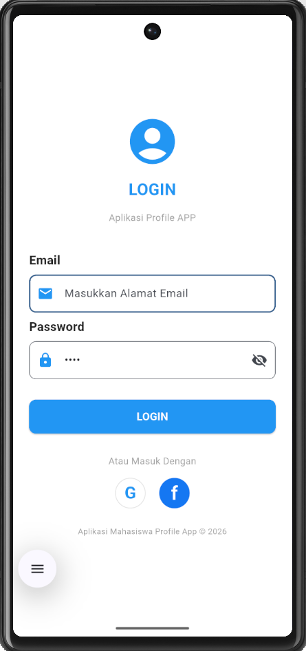
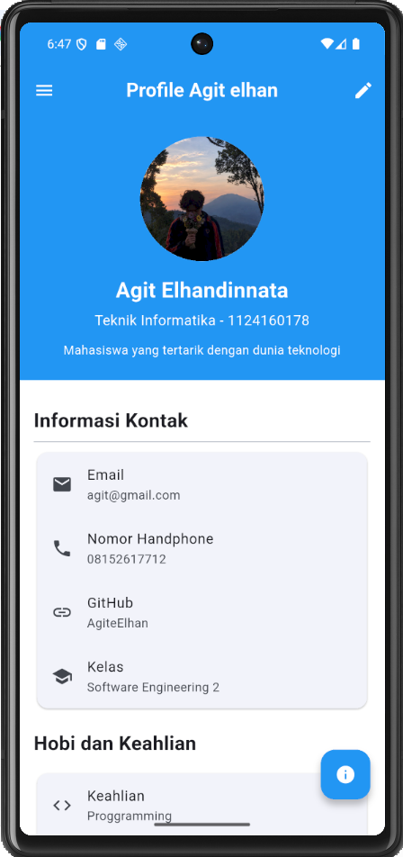
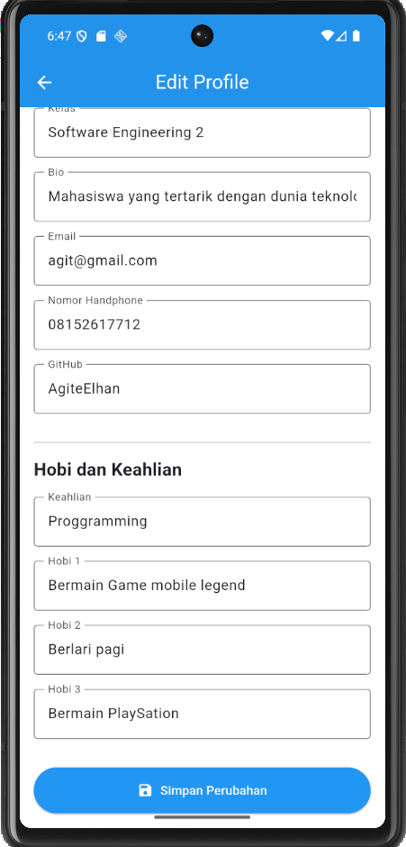
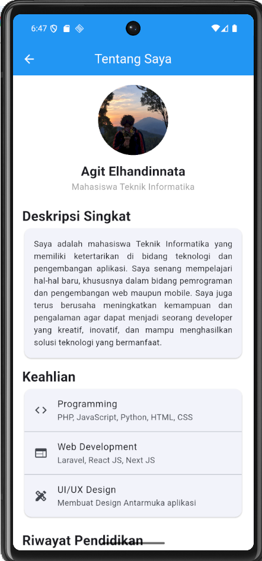

# Aplikasi Profil Mahasiswa - Flutter

Aplikasi Profil Mahasiswa adalah project Ujian Tengah Semester (UTS) mata kuliah Pemrograman Mobile. Aplikasi ini saya bangun pakai Flutter dengan bahasa pemrograman Dart.

## Identitas

| Keterangan | Informasi |
|---|---|
| Nama | Agit Elhandinnata |
| NIM | 1124160178 |
| Program Studi | Teknik Informatika |
| Konsentrasi | Software Engineering |
| Universitas | Institut Teknologi dan Bisnis Bina Sarana Global |

## 🎥 Video Presentasi

Link YouTube: **[Tonton Video Presentasi](https://youtu.be/OsuyAaG2V1Q?si=eU92C0ZCzGAsNBrr)**

## Screenshot Aplikasi

### 1. Halaman Login

Halaman pertama yang muncul saat aplikasi dibuka, jadi user harus login dulu sebelum bisa masuk ke fitur lainnya.



### 2. Halaman Profil

Halaman yang menampilkan data diri mahasiswa, seperti nama, NIM, program studi, kelas, dan info lainnya.



### 3. Halaman Edit Profil

Halaman untuk mengubah dan memperbarui data profil kalau ada informasi yang perlu diganti.



### 4. Halaman Tentang Saya

Halaman yang berisi deskripsi singkat tentang saya, daftar skill, dan riwayat pendidikan.



## Daftar Fitur

Fitur-fitur yang ada di aplikasi ini:

- **Login:** Halaman login dengan validasi input username dan password.
- **Profil Mahasiswa:** Menampilkan data identitas mahasiswa.
- **Edit Profil:** Mengubah dan memperbarui data profil mahasiswa.
- **Tentang Saya:** Menampilkan keahlian, hobi, dan riwayat pendidikan.
- **Navigasi:** Memudahkan user berpindah antarhalaman lewat menu yang tersedia di aplikasi.
- **Validasi Form:** Memastikan data yang diinput sudah sesuai aturan, sehingga tidak ada input yang kosong atau salah format.

## Teknologi yang Digunakan

- Flutter
- Dart
- Material Design
- Visual Studio Code

## Cara Menjalankan Project

### Prasyarat

Sebelum mulai, pastikan hal-hal berikut sudah siap:

- **Flutter SDK** sudah terinstal dan sudah masuk ke PATH. Cek dengan perintah `flutter --version`.
- **Git** sudah terinstal. Cek dengan `git --version`.
- **Visual Studio Code** dengan ekstensi **Flutter** dan **Dart**, atau bisa juga pakai Android Studio.
- **Emulator Android** (lewat Android Studio / AVD Manager), atau **HP Android fisik** dengan USB Debugging aktif.
- Jalankan `flutter doctor` di terminal untuk memastikan semua komponen sudah terkonfigurasi dengan benar. Kalau masih ada tanda silang (✗), selesaikan dulu sesuai petunjuk yang muncul.

### Langkah-langkah

**1. Clone Repository**

Buka terminal (atau Command Prompt/PowerShell), lalu jalankan:

```bash
git clone https://github.com/AgiteElhan/UTS_PML_1124160178.git
```

**2. Masuk ke Folder Project**

```bash
cd UTS_PML_1124160178
```

Kalau mau, folder ini bisa langsung dibuka di VS Code dengan perintah `code .`

**3. Install Dependencies**

Download semua package yang dibutuhkan project ini:

```bash
flutter pub get
```

Tunggu sampai muncul pesan `Process finished with exit code 0`. Kalau ada error di tahap ini, biasanya penyebabnya koneksi internet atau versi Flutter yang tidak cocok dengan project.

**4. Cek Device yang Tersedia**

Pastikan emulator sudah dinyalakan atau HP sudah tersambung, lalu cek apakah device terdeteksi:

```bash
flutter devices
```

Kalau device sudah muncul di daftar, berarti siap dipakai.

**5. Jalankan Aplikasi**

```bash
flutter run
```

Kalau ada lebih dari satu device yang terdeteksi, pilih salah satunya dengan menambahkan ID device:

```bash
flutter run -d <id_device>
```

Contoh: `flutter run -d emulator-5554`

Proses build pertama biasanya cukup lama, jadi tunggu saja sampai aplikasi muncul di device.

**6. Login ke Aplikasi**

Setelah aplikasi terbuka, kamu akan masuk ke halaman login. Masukkan username dan password sesuai yang sudah ditentukan di project, lalu lanjut menjelajahi halaman Profil, Edit Profil, dan Tentang Saya.

### Tips Saat Aplikasi Berjalan

- Tekan `r` di terminal untuk **hot reload** (perubahan kode langsung terlihat tanpa restart).
- Tekan `R` untuk **hot restart** (aplikasi dimulai ulang dari awal).
- Tekan `q` untuk menghentikan aplikasi.

